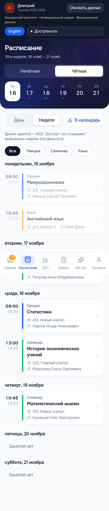
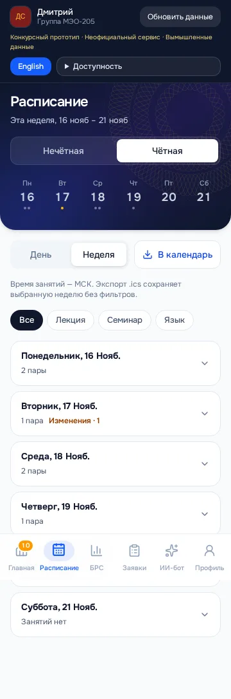
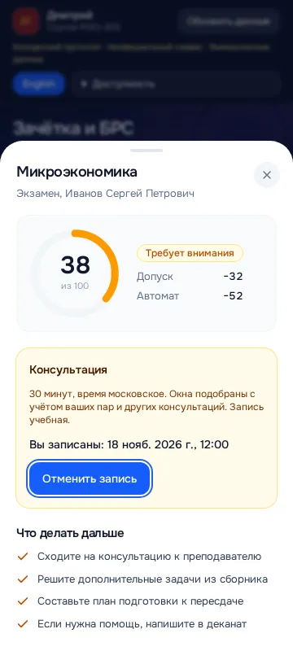

# Описание процесса создания

## Проблема

Расписание, оценки, документы и сообщения деканата находятся в разных системах. Студенту приходится помнить, где искать нужную информацию, а с телефона это особенно неудобно.

## Решение

«Цифровой деканат будущего» собирает ежедневные задачи в одном мобильном кабинете. Главный экран отвечает на вопрос «что у меня сегодня», раздел БРС показывает учебный прогресс, центр заявок сокращает путь до справки, а ИИ-ассистент подсказывает следующий шаг и может открыть оформление документа.

## Проработка сценариев

1. Алексей Волков показывает сценарий студента с высоким БРС и ролью старосты.
2. Дмитрий Соколов показывает сценарий риска: задолженность, пересдача и предупреждения.
3. София Чен показывает сценарий иностранной студентки: визовые документы и адаптационное расписание.

## Что сделано ИИ-ассистентом

- разбор требований конкурса и составление карты обязательных сценариев;
- проектирование mobile-first навигации и карточек;
- написание React-компонентов и типизированных моделей данных;
- рефакторинг авторизации и серверных API;
- подготовка текстов интерфейса, README и инструкции по деплою;
- генерация конкурсного описания и чек-листа приёмки.

Библиотеки проекта перечислены в `package.json` и README.

## Ключевые запросы к ИИ

> Сохрани текущий дизайн кабинета. Вынеси авторизацию и данные на сервер, чтобы студент не мог открыть чужой профиль или заявку подменой ID. Пароли не должны попадать в клиентский bundle.

> Проверь API: профиль студента должен определяться по защищённой сессии, а не по `studentData`, присланному браузером.

> Подготовь мобильную конкурсную версию для экранов от 360 px, сохрани карточную навигацию и добавь понятные состояния ошибки, загрузки и выхода из аккаунта.

## Архитектура входа и хранения

Сервер проверяет демонстрационный аккаунт через `scrypt`, выдаёт подписанную сессию в `HttpOnly` cookie и выбирает учебные данные по идентификатору пользователя. Состояние заявок, уведомлений и чата сохраняется в PostgreSQL по `owner_id`; в локальном режиме допускается непостоянный memory adapter. ИИ получает учебный контекст с сервера и не принимает профиль от браузера.

## Проверки и ограничения

Проверки, проведённые для текущего изменения, перечисляются в отчёте коммита и `docs/UPGRADE_SETUP.md`. Без безопасно настроенной тестовой базы нельзя считать PostgreSQL проверенным; production-готовность и визуальная браузерная приёмка отдельно не заявляются. Для промышленной версии потребуются управление ролями сотрудников, аудит, доставка второго фактора и общий limiter для всех Vercel-инстансов. В конкурсе используются только вымышленные seed-данные.

Актуальная архитектура обновления: PostgreSQL по `DATABASE_URL` вместо cookie состояния. Подробности и ограничения: `docs/UPGRADE_SETUP.md`.

## Проверка пакета 005 после code review

Исходная проверка выявила воспроизводимый откат этапа заявки при параллельной записи чата: этап 5 возвращался на 2. Также нашли устаревший ответ после объединения данных и необработанные ошибки чтения базы. Исправление повторяет отдельное действие на свежем состоянии вместо объединения старых копий.

В этой итерации использован ChatGPT/Codex для анализа, готового патча, перевода элементов интерфейса и тестов; Cursor остаётся инструментом применения пакета в пользовательском репозитории. PostgreSQL проверен на отдельном локальном сервере. Два независимых Node-процесса проверяют общую очередь ИИ. Playwright/Chromium проверяет реальные браузерные действия и снимает экраны 360/430/1280 px. Ответы Gemini в тестах подменены; реальный ключ и квота пользователя не использовались.

Ключевой запрос пользователя: «Исправь все. В промптах напиши код, чтобы Cursor не думал, а просто вставил». Поэтому вместе с diff подготовлены полные версии изменённых файлов, исполняемый установщик патча и промпт с точными командами. Визуальная проверка обнаружила белую подпись выбранной недели в контрастном режиме; ошибка исправлена и включена в браузерную проверку.

Применение миграций в Neon, настройка переменных Vercel и проверка живого Gemini выполняются владельцем проекта в его окружении. Эти ручные действия и результаты следует добавить в окончательный конкурсный PDF со своими скриншотами. Этот документ не заменяет фактическую историю всех инструментов команды и не подтверждает проведение опроса студентов.

## Итерация 006 — завершение сценариев

В этой итерации ChatGPT/Codex проанализировал исходники на коммите 21efffea78eb3651fdcace620c5f33a1a4ca3ba4, подготовил код, тесты и переносимый пакет для применения в Cursor. Дополнительные ИИ-агенты не использовались. PDF формируется программно; генераторы изображений не использовались. Для проверки документации PDF использовались официальные материалы pdf-lib. Noto Sans и его лицензия взяты из официального репозитория notofonts.

Ключевой запрос: «Напиши код для этого. Добавь это в папку патч с написанным кодом, патчами и промтом для курсора который это добавит в проект».

Изменения: отдельная серверная роль сотрудника, карточка приоритетов, отдельные результаты сессии, сохранение консультаций, цикл уточнения заявки, отмена, настоящий демонстрационный PDF, направление подготовки. Вымышленные пороги БРС явно названы учебными.

Результаты текущей проверки находятся в отчёте пакета VALIDATION_RU.md. Они не подтверждают выполнение команд в Cursor владельца, публикацию на Vercel, работу реального ИИ или доступ из России. Команде нужно добавить собственные скриншоты первой идеи и промежуточных версий, фактический полный список прежних инструментов и выполненные вручную действия. История разработки не выдумывалась.

Подробные постановки задач предыдущего этапа, инструменты, исправления и иллюстрации собраны в [журнале работы с ИИ](PROCESS_007.md).

## Доработка 17 ноября — от задолженности до свободного времени

Капитан сообщил об исправлении входа и поставил задачу: «Улучши проект на 40/40 с учетом того что я исправил вход и дай патч». При разборе версии `fcf59fa` Codex нашёл два разрыва в пользовательском пути. Кабинет предлагал консультацию ровно в полдень без учёта расписания студента. После записи задолженность и консультация могли занять два из трёх мест на главной. Источник наблюдений — код и демонстрационные данные. Интервью со студентами на этом этапе не проводились.

**Решение.** В карточке проблемной дисциплины студент выбирает один из доступных дней (до трёх вариантов). Сервер просматривает ближайшие две недели и ищет получасовые интервалы в 12:00, 14:00 и 16:00 МСК по рабочим дням. Он сверяет чётность недели, занятия и уже сохранённые записи этого студента. Когда студент нажимает «Записаться», сервер повторяет проверку на актуальных данных. На главной у дисциплины появляется дата консультации. Если сотрудник просит уточнение по справке, этот статус виден и в списке активных заявок на главной.

**Дизайн.** Чтобы выбрать день, достаточно сравнить шесть строк с датами, количеством пар и отметками изменений. Каждая строка раскрывает занятия с аудиторией и преподавателем. Для сравнения ниже — полные скриншоты из Chromium шириной 360 px, сделанные на демонстрационном аккаунте Дмитрия.

| До | После |
| --- | --- |
|  |  |

**Вклад ИИ и проверка.** ChatGPT/Codex сопоставил интерфейс с критериями конкурса, изменил React-компоненты и серверный TypeScript, написал проверки пересечений и тест раскрытия дня с клавиатуры. Node.js, ESLint, TypeScript и Vite использованы для проверки и сборки. Временная PostgreSQL и Playwright с Chromium использованы для прохождения маршрута от входа до записи и выдачи документа. ImageMagick преобразовал два браузерных скриншота в WebP; изображения интерфейса взяты из работающего приложения. Отдельно проверены три граничных случая: пара заходит на начало консультации, другая консультация уже занята или отменена, пара заканчивается ровно к началу свободного окна.

**Границы проверки.** Данные и часы консультаций демонстрационные. Об исправлении входа на опубликованном сайте сообщил капитан. Доступность из России до 28 ноября и ответы внешнего ИИ-провайдера требуют проверки на опубликованной версии.
