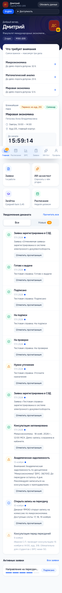
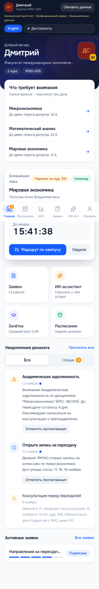
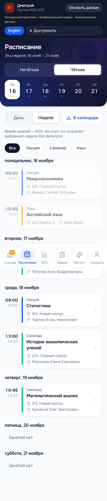
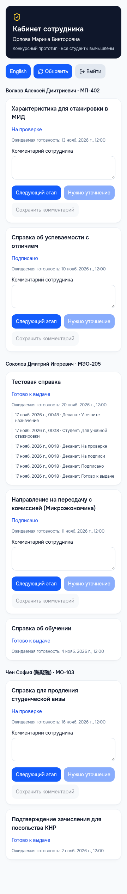
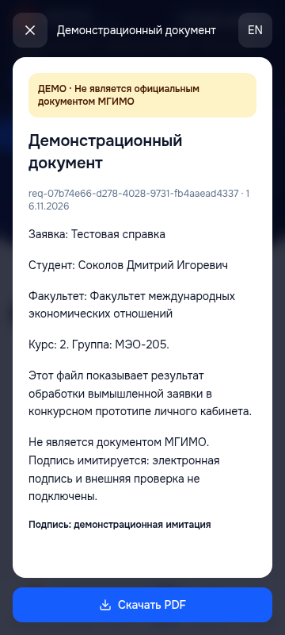
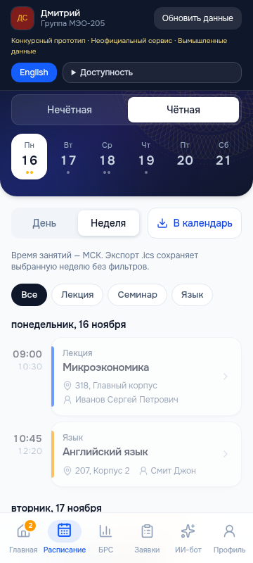
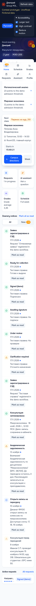

# Как дорабатывался цифровой деканат

Дата: 16 ноября 2026. Репозиторий: KusuoSaik/mgimo-deanery. Исходная версия: `70096ef5645868afdfaa39c830984bfa6dab8be9`. Это отчёт о проверяемой доработке существующего проекта; историю создания до этой версии нужно подтвердить отдельными материалами команды.

## Проблема и решение

Студенту нужны ответы «что у меня сегодня», «где риск по учёбе» и «что с моей справкой», а не перечень ведомственных систем. Поэтому ядро объединяет расписание, результаты учёбы, документы и уведомления. Приоритеты ведут к конкретной дисциплине или заявке. Можно записаться на демонстрационную консультацию, а сотрудник уточняет и обрабатывает заявку в отдельной роли. Третий сценарий — иностранная студентка с визовыми документами.

Дополнение текущего этапа: обзор всей недели помогает планировать нагрузку без шести переключений, а .ics переносит учебную неделю в привычный календарь. Экспорт — снимок выбранной недели в часовом поясе МСК, без идентификатора и персональных сведений студента. После импорта изменения не синхронизируются автоматически.

Интервью и опросы однокурсников в этой сессии не проводились. Сценарии выбраны по конкурсному заданию и проверены на вымышленных аккаунтах. Команда может добавить собственные исследования с реальными датами и обезличенными выводами.

## Фактически использованные инструменты

| Инструмент | Что делал |
| --- | --- |
| ChatGPT / Codex, текущая сессия | Аудит кода и требований, написание TypeScript/React/SQL, тестов, конфигурации хостинга, документов, собственного SVG значка |
| Cloud Environment, Bash, Git | Клонирование указанного репозитория, сравнение с исходным коммитом, выполнение команд и упаковка патча |
| Node.js, npm, TypeScript, ESLint, Vite | Установка по lockfile, типизация клиента/API/production-сервера, lint и сборка |
| Playwright + Chromium | Прохождение сценариев, отрицательные проверки доступа, размеры 360/430/1280 px, RU/EN, доступность, скачивание PDF/.ics, потеря сети, скриншоты |
| PostgreSQL 16 в Docker | Настоящее сохранение состояния и общих лимитов, независимые серверные процессы |
| Python + ReportLab, pdfinfo, pdftoppm | Сборка PDF из отчёта и реальных скриншотов, проверка страниц и кириллицы |
| Docker / Compose | Подготовка изолированного production-варианта и базы; HTTPS предусмотрен через Caddy |

Cursor в этой сессии не запускался: для него подготовлено отдельное задание на применение уже написанного патча и отправку в GitHub. Другие модели, Figma, генераторы картинок, интервью и работа команды вручную здесь не заявляются. Точная модель и инструмент исходного дизайна до коммита 70096ef по содержимому репозитория достоверно не установлены. Тексты прежних README описывают прошлые этапы и требуют подтверждения авторами.

## Запросы и этапы

Фактическое исходное задание пользователя: конкурсный бриф с обязательным ядром, безопасностью, мобильным экраном от 360 px и четырьмя критериями. Последующее поручение пользователя:

> «Пока не улучшишь этот проект на 40/40 не переставай думать и не смей давать ответ. Выполнять. Как сделаешь скидывай код и промпт в курсор что бы патч в проект и потом в гит хаб залил.»

Оценка 40/40 не объявляется результатом: её определяет жюри. Ниже — рабочие постановки, **реконструированные по выполненным действиям**, а не дополнительные сообщения пользователя и не поддельная стенограмма:

1. **Аудит:** «Сопоставь существующий репозиторий с обязательным ядром. Запусти имеющиеся проверки до изменений. Отдельно проверь роли, чужие заявки, сохранение, мобильность и правдивость демо-подсказок». Файлы: api/*, src/App.tsx, tests/*. Результат: базовые сценарии уже работали; найдены отсутствие лимита входа, общего лимита тела запроса, полного недельного обзора и вводящие в заблуждение подсказки пропуска.
2. **Защита входа:** «Сделай общий для нескольких процессов лимит попыток в PostgreSQL. Не храни введённые логины в лимитере. Известный и неизвестный аккаунт должны выполнять scrypt; пароль не должен попадать в bundle». Файлы: server/authLimiter.ts, api/auth.ts, api/_server.ts, migrations/003_auth_attempts.sql.
3. **Расписание:** «Сохрани существующую стилистику, добавь всю неделю и скачивание .ics с МСК, корректной кириллицей, переносами строк и защитой от внедрения событий через текст». Файлы: src/components/ScheduleView.tsx, src/scheduleCalendar.ts, tests/schedule-calendar.mts.
4. **Отказоустойчивость и честный демо:** «Покажи потерю соединения, сохрани понятный путь восстановления после сбоя интерфейса, явно обозначь неофициальность. Декоративный код не должен обещать проход в вуз». Файлы: ConnectionStatus.tsx, AppErrorBoundary.tsx, ProfileView.tsx, DashboardView.tsx.
5. **Хостинг и передача:** «Подготовь single-origin production-сервер, PostgreSQL, HTTPS на VPS, CI, инструкции для жюри и патч для Cursor. Не выдумывай публикацию, доступность из России или оценки». Файлы: server/production.ts, server/app.ts, Dockerfile, compose.yaml, .github/workflows/verify.yml, docs/*.

Правила для последующих ИИ-итераций оформлены в AGENTS.md. Изменения общего контракта src/types.ts не потребовались.

## Ошибки и исправления в процессе

- Первая загрузка GitHub из ограниченной оболочки не достигла прокси; повтор с разрешённым доступом среды получил репозиторий.
- Первая версия дополнения переводов повторяла уже существующий ключ. TypeScript отклонил сборку; ключ устранён, сборка повторена. Это показало пользу проверки типов после текстовых правок.
- Проверка lint выявила неиспользованный параметр Express error middleware. Параметр сохранён, поскольку четыре аргумента определяют middleware ошибок, и явно отмечен использованным.
- Локальный HTTP-тест в ограниченной оболочке не смог открыть порт (EPERM). Его повторили с разрешённым локальным запуском и проверили реальные HTTP-ответы.
- Обычная Docker-сборка в Cloud задержалась на доступе npm. Для повторной сборки использована временная копия Dockerfile с прокси и CA через BuildKit secret; SSL-проверка не отключалась, CA не добавлен в репозиторий или слои образа.

## Вход, хранение и защита простыми словами

Пароль проверяет сервер по scrypt-хешу. После входа браузер получает подписанную HttpOnly cookie: JavaScript не может прочитать её. В production обязательны случайный SESSION_SECRET и Secure cookie. Личность берётся из сессии, а не из адреса или переданного студентом ID. Дополнительный ownerId отклоняет запоздалую запись после смены аккаунта.

Заявки, уведомления, переписка и консультации сохраняются в PostgreSQL с отдельным owner_id. При одновременном изменении сервер повторяет конкретную операцию на свежей версии состояния. Студент не меняет этапы обработки: это право сотрудника. Доступ сотрудника к трём демо-студентам предусмотрен намеренно; для настоящего внедрения нужен реестр и ограничение по факультетам.

Попытки входа ограничены общим хранилищем PostgreSQL (30 на аккаунт за фиксированное окно 15 минут, 300 суммарно за минуту). Ключ аккаунта — SHA-256, введённые логины не сохраняются в этой таблице. Alias почты/телефона одного аккаунта разделяет один лимит. Это защита прототипа, а не промышленная система против распределённых атак. Публичные тестовые пароли по заданию известны жюри.

API ограничивает JSON размером 256 KiB, отклоняет чужой Origin/cross-site, ограничивает размер пароля и проверяет форму JSON. Асинхронный scrypt не блокирует цикл событий. В production неполная настройка базы/секрета не переключает приложение на незащищённый режим. Ключ ИИ хранится на сервере, браузер обращается только к /api/chat; live-провайдер отдельно требует настройки и проверки. Модель предлагает действие, отправку подтверждает студент.

## Что проверено

Подробный перечень — CONTEST_READINESS.md. API-тесты прошли с памятью и с отдельной PostgreSQL. Отдельные процессы подтвердили сохранение состояния, общность лимита входа и общего слота ИИ. Браузерная проверка прошла с PostgreSQL: 360/430/1280 px, три роли (два студента и сотрудник), заявки/уточнения/PDF, консультации, RU/EN, крупный текст/контраст/фокус, .ics, offline-уведомление, изоляция позднего ответа ИИ. Вызовы ИИ в тестах подменены.

Production-образ собран и запущен на Node.js 22: проверены SPA/API, healthz, два студента, создание/отмена заявки, запрет чужого доступа, Secure/HttpOnly/SameSite и защитные заголовки. Публичный TLS не проверялся. В Cloud потребовались временный proxy/CA secret и сокращение избыточных слоёв Docker после нехватки диска; постоянный Dockerfile не содержит инфраструктуры Cloud.

`npm audit --omit=dev` сообщил 0 уязвимостей; полный audit отмечает moderate в minimatch/ESLint (инструменты разработки, не runtime образа). Это ограничение зафиксировано, принудительная несовместимая major-подмена не выполнялась.

Скриншоты в evidence/ сделаны настоящим Chromium, не генератором изображений. «До» относится к исходному коммиту; «после» — к текущим изменениям. Первая идея и исходные макеты проекта не создавались заново ради отчёта. Если их нет у команды, так и следует указать.

## Ручная работа и оставшиеся действия капитана

В этой сессии человек предоставил конкурсное задание и URL проекта. Аудит, код, тесты и документы выполнял ИИ-ассистент инструментами; ручные опросы или ручное программирование не приписываются человеку.

Капитану предстоит применить патч в своём checkout, проверить и отправить код через Cursor, настроить домен/серверные секреты, подтвердить публичную доступность из России без VPN и срок работы до 28 ноября, добавить подтверждения предыдущих этапов разработки и полный список инструментов команды, заменить шаблонные ссылки и отправить работу. Внешний production-деплой и живая модель ИИ в этой сессии не выдаются за проверенные.

## Скриншоты текущего этапа

До доработки, исходная версия:

После доработки, маркировка концепта и приоритеты:

Вся учебная неделя и экспорт:

Уточнение и обработка сотрудником:

Результат обработки — демонстрационный PDF:

Сбой соединения:

Доступность и английский язык:

